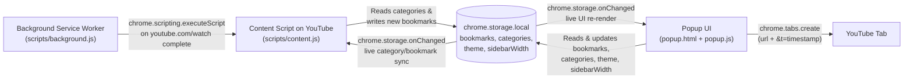

# 🔖 SaveTube - Bookmark YouTube Videos

SaveTube is a lightweight, privacy-first Chrome Extension (Manifest V3) for saving timestamped YouTube video bookmarks and organizing them into custom categories directly from the YouTube video player.

---

## 🎯 Purpose

Watching long tutorials, lectures, podcasts, or multi-part videos often makes it tedious to keep track of exact moments you want to revisit. SaveTube solves this by letting you:

- ⏱️ **Capture exact timestamps in-player**: Add a bookmark directly from the YouTube player controls (or by pressing `A`) without leaving the video.
- 🗂️ **Customize and organize**: Give each bookmark a custom name and assign it to custom categories (with a built-in `All` view).
- ▶️ **Resume playback instantly**: Open any saved bookmark in a new tab at its exact timestamp (`&t=<seconds>`).
- 🔍 **Search and manage effortlessly**: Filter bookmarks by category, search by custom name (press `/` to focus search), rename or delete items, resize or collapse the sidebar, and switch between light and dark themes.
- 🔒 **Keep data 100% local**: Zero backend servers, analytics, or external network requests—all bookmarks and preferences stay in Chrome's local extension storage.

---

## 🧰 Tech Stack

| Layer | Technology |
| :--- | :--- |
| 🧩 **Platform** | Chrome Extension API (Manifest V3) |
| 💻 **Language** | Vanilla JavaScript (ES Modules in popup; standalone injected script on YouTube) |
| 🎨 **Markup & Styling** | HTML5, CSS3 (attribute-driven `data-theme="light" \| "dark"` theming, injected scoped CSS for the player overlay) |
| 🔌 **Browser APIs** | `chrome.storage.local`, `chrome.tabs`, `chrome.scripting`, `chrome.runtime` |
| 🌐 **Web APIs** | `crypto.randomUUID()`, Pointer Events (`setPointerCapture` for resizable sidebar), DOM / CSS Transitions |
| 📦 **Dependencies / Build** | None (zero external packages, zero bundler required) |

---

## 🏗️ Design Architecture

SaveTube follows a **decoupled, storage-driven extension architecture** across three browser execution contexts—a Background Service Worker, a YouTube Content Script, and the Extension Popup—using `chrome.storage.local` as the single source of truth and `chrome.storage.onChanged` for reactive synchronization.



### 📁 Project Structure

```text
SaveTube/
├── manifest.json           # Manifest V3 configuration, permissions, and entry points
├── popup.html              # Popup shell (header, sidebar, bookmark list, delete modal)
├── popup.css               # Light/dark themes, layout, cards, sidebar, and modal styles
├── popup.js                # Popup ES module bootstrapper
├── scripts/
│   ├── background.js       # Service worker injecting content.js on YouTube watch pages
│   ├── content.js          # In-player bookmark button, tooltip, and save modal overlay
│   ├── bookmark.js         # Bookmark card rendering, search, playback, rename, and delete
│   ├── categories.js       # Category list CRUD, context menu, and active filtering
│   ├── sidebar.js          # Collapsible and pointer-resizable sidebar logic
│   ├── shortcuts.js        # Popup keyboard shortcuts ('/' to focus search)
│   ├── theme.js            # Light/dark theme toggle and persistence
│   ├── state.js            # In-memory active category state (activeCategoryId)
│   └── storage.js          # Promise-based wrappers for chrome.storage.local
├── icons/                  # Extension icons and in-player bookmark button asset
├── LICENSE                 # MIT License
└── PRIVACY_POLICY.md       # Local-only data & permissions disclosure
```

### 🧩 Component Breakdown

1. ⚙️ **Background Service Worker ([`scripts/background.js`](scripts/background.js))**
   - Listens to `chrome.tabs.onUpdated`. When a tab finishes loading (`changeInfo.status === 'complete'`) on a `youtube.com/watch` URL, it programmatically injects `scripts/content.js` using `chrome.scripting.executeScript`.

2. 📺 **YouTube Page Content Script ([`scripts/content.js`](scripts/content.js))**
   - Guards against duplicate execution with `window.__ytBookmarkerLoaded`.
   - Injects scoped overlay CSS into `document.head` and prepends `.add-bookmark-button` into YouTube's `.ytp-right-controls` player bar with a hover tooltip (`Add Bookmark (A)`).
   - Supports keyboard shortcuts on watch pages (`A` to toggle the save modal, `Enter` to save when not typing in an input/textarea).
   - Extracts `videoTitle`, `channelName`, base `videoUrl`, and floored `video.currentTime` (`timestamp`) from the active YouTube DOM.
   - Displays an in-player modal with a custom name input and a custom category dropdown populated from `chrome.storage.local` (and kept in sync via `chrome.storage.onChanged`).
   - Uses local Promise wrappers around `chrome.storage.local` (since injected scripts run as classic scripts rather than ES modules).

3. 🪟 **Extension Popup ([`popup.html`](popup.html), [`popup.css`](popup.css), [`popup.js`](popup.js))**
   - `popup.js` acts as a thin composition root that initializes five independent ES modules:
     - 🌗 **Theme (`scripts/theme.js`)**: Applies `data-theme="light" | "dark"` on `#popup`, swaps sun/moon SVG icons, and persists `theme`.
     - 🗂️ **Categories (`scripts/categories.js`)**: Renders the fixed `All` virtual category alongside user-created categories, handles inline creation/renaming (50-char limit), provides a `⋮` context menu, and reassigns bookmarks to `'all'` when a category is deleted.
     - 🔖 **Bookmarks (`scripts/bookmark.js`)**: Renders bookmark cards with expandable metadata (`Title`, `Channel`, formatted `Timestamp`, `Saved` date, `Category`), opens timestamped tabs via `chrome.tabs.create`, supports inline renaming (150-char limit) and confirmation-gated deletion, filters by search query, and subscribes to `chrome.storage.onChanged` for live updates.
     - ↔️ **Sidebar (`scripts/sidebar.js`)**: Supports pointer-captured drag resizing (default `100px`, max `190px`, snaps closed below `80px`) and toggle button collapse/expand, persisted as `sidebarWidth`.
     - ⌨️ **Shortcuts (`scripts/shortcuts.js`)**: Focuses `#search-input` when `/` is pressed outside text inputs.

4. 💾 **Shared State & Storage (`scripts/state.js`, `scripts/storage.js`)**
   - `state.js` maintains the popup's active filter (`activeCategoryId`, defaulting to `'all'`).
   - `storage.js` wraps `chrome.storage.local.get` and `chrome.storage.local.set` in Promises with `chrome.runtime.lastError` handling.

### 🗃️ Storage Schema (`chrome.storage.local`)

| Key | Type | Description |
| :--- | :--- | :--- |
| `bookmarks` | `Array<Bookmark>` | `{ id, customName, youtubeTitle, channel, url, timestamp, categoryId, savedAt }` |
| `categories` | `Array<Category>` | `{ id, name }` |
| `theme` | `'light' \| 'dark'` | Active popup UI theme (defaults to `'light'`) |
| `sidebarWidth` | `number` | Saved sidebar width in pixels (`0` when collapsed, default `100`, max `190`) |

---

## 📄 License

This project is licensed under the **MIT License** — see the [LICENSE](LICENSE) file for full details.

```text
MIT License

Copyright (c) 2026 Saqib1L

Permission is hereby granted, free of charge, to any person obtaining a copy
of this software and associated documentation files (the "Software"), to deal
in the Software without restriction, including without limitation the rights
to use, copy, modify, merge, publish, distribute, sublicense, and/or sell
copies of the Software, and to permit persons to whom the Software is
furnished to do so, subject to the following conditions:

The above copyright notice and this permission notice shall be included in all
copies or substantial portions of the Software.

THE SOFTWARE IS PROVIDED "AS IS", WITHOUT WARRANTY OF ANY KIND, EXPRESS OR
IMPLIED, INCLUDING BUT NOT LIMITED TO THE WARRANTIES OF MERCHANTABILITY,
FITNESS FOR A PARTICULAR PURPOSE AND NONINFRINGEMENT. IN NO EVENT SHALL THE
AUTHORS OR COPYRIGHT HOLDERS BE LIABLE FOR ANY CLAIM, DAMAGES OR OTHER
LIABILITY, WHETHER IN AN ACTION OF CONTRACT, TORT OR OTHERWISE, ARISING FROM,
OUT OF OR IN CONNECTION WITH THE SOFTWARE OR THE USE OR OTHER DEALINGS IN THE
SOFTWARE.
```